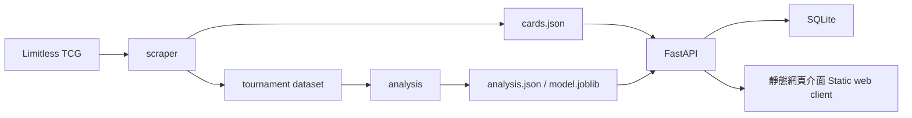
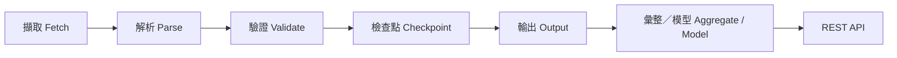

# PTCG Pocket DataBrowser

這是一個以 Python 後端與資料管線為核心的作品集專案，用於探索 Pokémon TCG Pocket 卡牌、賽事結果、牌組原型，以及提供輕量的牌組表現估計。

## 專案特色

- 以 FastAPI + SQLModel 建構 API，提供牌組 CRUD、健康狀態、預測與環境（meta）端點
- 可續跑的資料蒐集流程，包含驗證、checkpoint 與失敗 URL 追蹤
- 賽事資料彙整與選用的 ML 產物，供 API 的環境與預測回應使用
- 著重後端品質實務：pytest 覆蓋率、Docker 打包，以及在 Python 3.11 與 3.12 上執行的 GitHub Actions

## 系統架構



## ETL 資料流程



## 在本機執行

先安裝專案相依套件，再啟動 API：

```bash
python -m pip install -r requirements.txt
python -m uvicorn api.main:app --port 8000
```

API 位於 `http://localhost:8000`；互動式 API 文件位於 `http://localhost:8000/docs`。靜態用戶端在 `web/`，可使用任一本機靜態檔案伺服器提供服務。

選用的資料庫設定如下：

```bash
DATABASE_URL=sqlite:///data/decks.db
```

未設定時，應用程式會使用 `data/` 下的絕對 SQLite 路徑。

## 蒐集與分析資料

卡牌爬蟲從 [Limitless TCG](https://pocket.limitlesstcg.com) 讀取資料。它會將卡牌資料寫入 `data/cards.json`、將進度記錄在 `data/cards.checkpoint.json`，並將無法蒐集的 URL 寫入 `data/failed_urls.json`。

```bash
python -m scraper --test
python -m analysis
```

`python -m scraper --test` 是一次小規模的資料蒐集。一般爬蟲支援可續跑的 checkpoint、系列選擇與不續跑模式；請執行 `python -m scraper --help` 查看命令列選項。分析需要先蒐集 `data/tournaments/dataset.json`，接著會建立 `data/analysis.json`；ML 訓練也可能額外建立 `data/model.joblib`。

## API

| 方法 | 路徑 | 用途 |
| --- | --- | --- |
| `GET` | `/api/health` | 應用程式健康狀態 |
| `GET/POST` | `/api/decks` | 列出或建立牌組 |
| `GET/PUT/DELETE` | `/api/decks/{id}` | 讀取、完整取代或刪除單一牌組 |
| `POST` | `/api/predict` | 估計牌組表現 |
| `GET` | `/api/meta` | 回傳目前的牌組原型環境資料 |

## 測試與品質檢查

以下指令可執行完整測試套件與覆蓋率報告：

```bash
python -m pytest --cov=scraper --cov=analysis --cov=api --cov-report=term-missing
```

儲存庫也包含在 Python 3.11 與 3.12 上執行的 GitHub Actions 檢查。

## Docker

以下指令可建置並執行 API 容器：

```bash
docker build -t ptcg-pocket-databrowser .
docker run --rm -p 8000:8000 ptcg-pocket-databrowser
```

上述映像已完成實際建置與執行驗證：`/api/health` 回傳 `{"status":"ok"}`、容器 `HEALTHCHECK` 為 `healthy`，且服務以非 root 的 `app` 使用者執行。驗證完成後已移除測試容器。

## 資料與模型說明

本專案使用來自 [Limitless TCG tournament API](https://play.limitlesstcg.com) 的已蒐集 Pokémon TCG Pocket 賽事樣本。單場對局結果變異很大：查表法與選用 ML 模型的 AUC 都約為 **0.55**，因此兩者都不能可靠地區分牌組是否成功。查表法在已看過的對戰組合上略佳，但在樣本很小的 0%/100% 儲存格中可能校準不佳。ML 模型的 log-loss 為 **0.69**；查表法的 log-loss 為 **1.55**。ML 模型可涵蓋約 **25%** 未被查表法看過的對戰組合。這些訊號會一併呈現，而非當作虛假的精確保證。

## 限制

- 結果描述的是已蒐集的賽事樣本，不保證未來結果。
- SQLite 是此儲存庫已驗證的資料持久化後端。
- ML 模型為選用項目；沒有模型產物時，API 的 ML 輸出會回傳 `null`。

此儲存庫沒有公開部署；文件記載的持久化設定為 SQLite。
