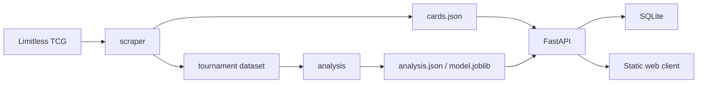
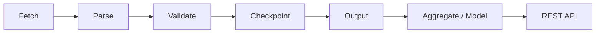

# PTCG Pocket DataBrowser

A Python backend and data pipeline portfolio project for exploring **Pokémon TCG Pocket** cards, tournament results, deck archetypes, and a lightweight deck-performance estimate. It pairs a reproducible scraper and analysis workflow with a FastAPI application, SQLite persistence, and a static web client.

## Highlights

- FastAPI + SQLModel API with deck CRUD, health, prediction, and meta endpoints
- Resumable data collection with validation, checkpoints, and failed-URL tracking
- Tournament aggregation and optional ML artifacts that feed the API's meta and prediction responses
- Backend-focused quality practices: pytest coverage, Docker packaging, and GitHub Actions across Python 3.11 and 3.12

## Architecture



## ETL flow



## Run locally

Install the project dependencies, then start the API:

```bash
python -m pip install -r requirements.txt
python -m uvicorn api.main:app --port 8000
```

The API is available at `http://localhost:8000`; interactive API documentation is at `http://localhost:8000/docs`. The static client is in `web/` and can be served by any local static-file server.

The optional database setting is:

```bash
DATABASE_URL=sqlite:///data/decks.db
```

Without this setting, the application uses an absolute SQLite path under `data/`.

## Collect and analyze data

The card scraper reads from [Limitless TCG](https://pocket.limitlesstcg.com). It writes card data to `data/cards.json`, records progress in `data/cards.checkpoint.json`, and writes URLs that could not be collected to `data/failed_urls.json`.

```bash
python -m scraper --test
python -m analysis
```

`python -m scraper --test` is a small collection run. The normal scraper supports resumable checkpoints, set selection, and a no-resume mode; run `python -m scraper --help` for its command-line options. Analysis expects a previously collected `data/tournaments/dataset.json`, then creates `data/analysis.json`; ML training can additionally create `data/model.joblib`.

## API

| Method | Path | Purpose |
| --- | --- | --- |
| `GET` | `/api/health` | Application health |
| `GET/POST` | `/api/decks` | List or create decks |
| `GET/PUT/DELETE` | `/api/decks/{id}` | Read, replace, or delete one deck |
| `POST` | `/api/predict` | Estimate deck performance |
| `GET` | `/api/meta` | Return the current archetype meta |

## Tests and quality checks

Run the full test suite and its coverage report with:

```bash
python -m pytest --cov=scraper --cov=analysis --cov=api --cov-report=term-missing
```

The repository also includes GitHub Actions coverage for Python 3.11 and 3.12.

## Docker

Build and run the API container with:

```bash
docker build -t ptcg-pocket-databrowser .
docker run --rm -p 8000:8000 ptcg-pocket-databrowser
```

These are the repository's container startup commands. Docker was not available in the local verification environment for this documentation update, so no local container runtime result is claimed here.

## Data and model notes

The project uses the collected Pokémon TCG Pocket tournament sample from the [Limitless TCG tournament API](https://play.limitlesstcg.com). Single-match outcomes are highly variable: both the matchup lookup and optional ML model have AUC of about **0.55**, so neither is a reliable discriminator of deck success. The lookup is slightly better for matchups it has seen but can be poorly calibrated in small 0%/100% cells. The ML model has log-loss of **0.69** versus **1.55** for the lookup comparison and can cover about **25%** of matchups not seen by the lookup; these signals are presented together rather than as a falsely precise guarantee.

## Limitations

- Results describe the collected tournament sample, not future guaranteed outcomes.
- SQLite is the verified persistence backend in this repository.
- The ML model is optional; the API returns `null` for ML output when no model artifact is present.

This repository includes no hosted deployment; its documented persistence configuration is SQLite.
