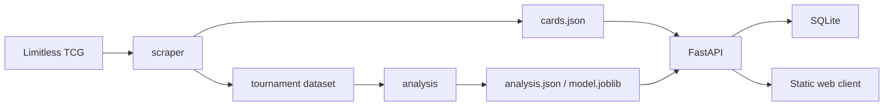
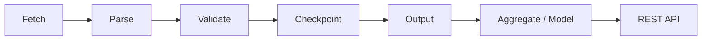

# Portfolio Backend Hardening Implementation Plan

> **For agentic workers:** REQUIRED SUB-SKILL: Use superpowers:subagent-driven-development (recommended) or superpowers:executing-plans to implement this plan task-by-task. Steps use checkbox (`- [ ]`) syntax for tracking.

**Goal:** Strengthen PTCG Pocket DataBrowser into a portfolio project led by Python backend engineering evidence, with the existing scraping and analysis pipeline supporting a secondary data-engineering narrative.

**Architecture:** Preserve the current `scraper → analysis → api → web` flow. Add explicit API schemas, app-scoped database configuration, a lightweight health endpoint, a reproducible container, CI, and portfolio-oriented documentation without introducing unrelated infrastructure.

**Tech Stack:** Python 3.11/3.12, FastAPI, Pydantic, SQLModel, SQLite, pytest, pytest-cov, Docker, GitHub Actions, vanilla HTML/CSS/JavaScript.

## Global Constraints

- Keep `scraper`, `analysis`, `api`, and `web` as the four principal application boundaries.
- Keep SQLite as the verified default database; allow `DATABASE_URL` overrides without claiming untested PostgreSQL support.
- Deck names must be trimmed and contain 1–100 characters.
- Card `set` and `number` values must be trimmed and contain 1–20 characters.
- Card `count` must be either 1 or 2.
- Prediction requests must contain at least one card.
- User input validation errors use FastAPI's standard HTTP `422` response.
- Do not add authentication, Redis, Kafka, microservices, cloud infrastructure, or a PostgreSQL container.
- Every Python behavior change follows red-green-refactor; configuration files are verified through build or workflow checks.
- Preserve all existing tests and do not hide third-party warnings globally.

---

## Planned File Structure

### Files to create

- `api/schemas.py` — external request and response contracts only.
- `tests/test_db.py` — database URL and engine-option behavior.
- `tests/test_api_health.py` — health endpoint integration behavior.
- `.env.example` — documented local database setting.
- `.dockerignore` — Docker build-context exclusions.
- `Dockerfile` — reproducible FastAPI runtime image.
- `.github/workflows/tests.yml` — Python 3.11/3.12 automated test matrix.

### Files to modify

- `api/models.py` — database table model only.
- `api/routers/decks.py` — translate validated schemas to JSON persistence.
- `api/routers/predict.py` — consume the shared validated card schema.
- `api/db.py` — database URL resolution, engine options, and app-scoped sessions.
- `api/main.py` — create and store the database engine and expose health status.
- `tests/test_api_decks.py` — validation coverage and app-factory database setup.
- `tests/test_api_predict.py` — prediction request validation and app-factory setup.
- `tests/test_pipeline.py` — assert the existing pipeline summary contract.
- `requirements-dev.txt` — use Starlette's current `httpx2` TestClient dependency.
- `.gitignore` — exclude local `.env`.
- `README.md` — portfolio-oriented system, data-flow, API, Docker, CI, and limitation documentation.

---

### Task 1: Explicit API Schemas and Validation

**Files:**

- Create: `api/schemas.py`
- Modify: `api/models.py:7-38`
- Modify: `api/routers/decks.py:6-37`
- Modify: `api/routers/predict.py:4-51`
- Modify: `tests/test_api_decks.py:22-65`
- Modify: `tests/test_api_predict.py:41-68`

**Interfaces:**

- Produces: `CardInput`, `DeckWrite`, `DeckRead`, and `PredictRequest` in `api.schemas`.
- `CardInput.model_dump(exclude_none=True)` produces JSON-serializable card dictionaries.
- `DeckWrite.cards` is `list[CardInput]`; an empty list remains valid so unfinished decks can be saved.
- `PredictRequest.cards` is `list[CardInput]` with a minimum length of one.
- `Deck` remains the SQLModel table with JSON-backed card dictionaries.

- [ ] **Step 1: Add failing deck validation tests**

Append these tests to `tests/test_api_decks.py`:

```python
@pytest.mark.parametrize(
    "payload",
    [
        {"name": "   ", "cards": []},
        {"name": "x" * 101, "cards": []},
        {"name": "Deck", "cards": [{"set": "", "number": "1", "count": 1}]},
        {"name": "Deck", "cards": [{"set": "A1", "number": "", "count": 1}]},
        {"name": "Deck", "cards": [{"set": "A1", "number": "1", "count": 0}]},
        {"name": "Deck", "cards": [{"set": "A1", "number": "1", "count": 3}]},
    ],
)
def test_create_deck_rejects_invalid_payload(client, payload):
    response = client.post("/api/decks", json=payload)
    assert response.status_code == 422


def test_create_deck_trims_text_fields(client):
    response = client.post(
        "/api/decks",
        json={
            "name": "  Trimmed Deck  ",
            "cards": [{"set": " A1 ", "number": " 1 ", "count": 1}],
        },
    )

    assert response.status_code == 201
    body = response.json()
    assert body["name"] == "Trimmed Deck"
    assert body["cards"][0]["set"] == "A1"
    assert body["cards"][0]["number"] == "1"
```

- [ ] **Step 2: Add failing prediction validation tests**

Append these tests to `tests/test_api_predict.py`:

```python
def test_predict_rejects_empty_card_list(client):
    response = client.post("/api/predict", json={"cards": []})
    assert response.status_code == 422


@pytest.mark.parametrize(
    "card",
    [
        {"set": "", "number": "1", "count": 1},
        {"set": "A1", "number": "", "count": 1},
        {"set": "A1", "number": "1", "count": 0},
        {"set": "A1", "number": "1", "count": 3},
    ],
)
def test_predict_rejects_invalid_card(client, card):
    response = client.post("/api/predict", json={"cards": [card]})
    assert response.status_code == 422
```

- [ ] **Step 3: Run the new tests and confirm the expected failures**

Run:

```bash
python -m pytest tests/test_api_decks.py tests/test_api_predict.py -q
```

Expected: the new invalid-input assertions fail because the current endpoints accept unvalidated dictionaries; existing tests remain green.

- [ ] **Step 4: Create the external schemas**

Create `api/schemas.py`:

```python
"""External API request and response contracts."""
from __future__ import annotations

from datetime import datetime

from pydantic import BaseModel, ConfigDict, Field, field_validator


def _strip_text(value: object) -> object:
    return value.strip() if isinstance(value, str) else value


class CardInput(BaseModel):
    model_config = ConfigDict(extra="forbid")

    set: str = Field(min_length=1, max_length=20)
    number: str = Field(min_length=1, max_length=20)
    name: str | None = Field(default=None, max_length=200)
    count: int = Field(default=1, ge=1, le=2)

    @field_validator("set", "number", "name", mode="before")
    @classmethod
    def strip_text_fields(cls, value: object) -> object:
        return _strip_text(value)


class DeckWrite(BaseModel):
    model_config = ConfigDict(extra="forbid")

    name: str = Field(min_length=1, max_length=100)
    cards: list[CardInput] = Field(default_factory=list)

    @field_validator("name", mode="before")
    @classmethod
    def strip_name(cls, value: object) -> object:
        return _strip_text(value)


class DeckRead(BaseModel):
    model_config = ConfigDict(from_attributes=True)

    id: int
    name: str
    cards: list[CardInput]
    created_at: datetime


class PredictRequest(BaseModel):
    model_config = ConfigDict(extra="forbid")

    cards: list[CardInput] = Field(min_length=1)
```

- [ ] **Step 5: Limit `api.models` to persistence**

Replace the schema classes in `api/models.py` so the module ends after `Deck`:

```python
class Deck(SQLModel, table=True):
    """A deck persisted in SQLite."""

    id: int | None = Field(default=None, primary_key=True)
    name: str
    cards: list[dict[str, Any]] = Field(
        default_factory=list,
        sa_column=Column(JSON),
    )
    created_at: datetime = Field(default_factory=_now)
```

- [ ] **Step 6: Use validated schemas in deck routes**

Update imports and write conversion in `api/routers/decks.py`:

```python
from ..models import Deck
from ..schemas import DeckRead, DeckWrite


def _card_dicts(data: DeckWrite) -> list[dict]:
    return [card.model_dump(exclude_none=True) for card in data.cards]
```

Change both write endpoint signatures and assignments:

```python
def create_deck(data: DeckWrite, session: Session = Depends(get_session)):
    deck = Deck(name=data.name, cards=_card_dicts(data))
```

```python
def update_deck(
    deck_id: int,
    data: DeckWrite,
    session: Session = Depends(get_session),
):
    # existing 404 branch remains unchanged
    deck.name = data.name
    deck.cards = _card_dicts(data)
```

- [ ] **Step 7: Use validated schemas in prediction routes**

In `api/routers/predict.py`, remove `BaseModel`, import the schemas, and convert only at the router boundary:

```python
from ..schemas import CardInput, PredictRequest


def _to_decklist(
    cards: list[CardInput],
    store: AnalysisStore,
) -> dict[str, Any]:
    pokemon: list[dict[str, Any]] = []
    trainer: list[dict[str, Any]] = []
    for card in cards:
        row = card.model_dump(exclude_none=True)
        info = store.card_index.get(f"{card.set}-{card.number}")
        target = trainer if info and info.get("card_type") == "trainer" else pokemon
        target.append(row)
    return {"pokemon": pokemon, "trainer": trainer}
```

Delete the local `PredictRequest` class. Keep the prediction algorithm unchanged.

- [ ] **Step 8: Run focused and complete tests**

Run:

```bash
python -m pytest tests/test_api_decks.py tests/test_api_predict.py -q
python -m pytest -q
```

Expected: all deck and prediction validation tests pass, followed by the complete suite with zero failures.

- [ ] **Step 9: Commit Task 1**

```bash
git add api/models.py api/schemas.py api/routers/decks.py api/routers/predict.py tests/test_api_decks.py tests/test_api_predict.py
git commit -m "feat(api): validate deck and prediction payloads"
```

---

### Task 2: App-Scoped Database Configuration

**Files:**

- Create: `tests/test_db.py`
- Create: `.env.example`
- Modify: `api/db.py:1-29`
- Modify: `api/main.py:13-39`
- Modify: `tests/test_api_decks.py:2-19`
- Modify: `tests/test_api_predict.py:2-38`
- Modify: `.gitignore:1-23`

**Interfaces:**

- Produces: `get_database_url() -> str`.
- Produces: `engine_options(database_url: str) -> dict[str, Any]`.
- Produces: `create_db_engine(database_url: str) -> Engine`.
- Changes: `init_db(engine: Engine) -> None`.
- Changes: `create_app(database_url: str | None = None) -> FastAPI`.
- `get_session(request: Request)` reads `request.app.state.db_engine`.

- [ ] **Step 1: Write failing settings and engine-option tests**

Create `tests/test_db.py`:

```python
from api import db


def test_get_database_url_uses_environment(monkeypatch):
    monkeypatch.setenv("DATABASE_URL", "sqlite:///custom.db")
    assert db.get_database_url() == "sqlite:///custom.db"


def test_sqlite_engine_options_enable_cross_thread_access():
    assert db.engine_options("sqlite:///data/decks.db") == {
        "connect_args": {"check_same_thread": False}
    }


def test_non_sqlite_engine_options_are_empty():
    assert db.engine_options("postgresql+psycopg://user:secret@db/app") == {}
```

- [ ] **Step 2: Add an app-factory environment test**

Append to `tests/test_db.py`:

```python
def test_create_app_uses_environment_database_url(monkeypatch, tmp_path):
    database_url = f"sqlite:///{tmp_path / 'configured.db'}"
    monkeypatch.setenv("DATABASE_URL", database_url)

    from api.main import create_app

    app = create_app()
    assert str(app.state.db_engine.url) == database_url
```

- [ ] **Step 3: Run the database tests and confirm missing-interface failures**

Run:

```bash
python -m pytest tests/test_db.py -q
```

Expected: failures report that `get_database_url` and `engine_options` do not exist and that the app has no `db_engine` state.

- [ ] **Step 4: Implement database URL and engine helpers**

Replace the module-level engine in `api/db.py` with:

```python
"""Database URL, engine, schema, and request-session management."""
from __future__ import annotations

import os
from typing import Any

from fastapi import Request
from sqlalchemy.engine import Engine, make_url
from sqlmodel import Session, SQLModel, create_engine

from scraper.config import DATA_DIR

DB_PATH = DATA_DIR / "decks.db"
DEFAULT_DATABASE_URL = f"sqlite:///{DB_PATH.as_posix()}"


def get_database_url() -> str:
    return os.environ.get("DATABASE_URL", DEFAULT_DATABASE_URL)


def engine_options(database_url: str) -> dict[str, Any]:
    if make_url(database_url).get_backend_name() == "sqlite":
        return {"connect_args": {"check_same_thread": False}}
    return {}


def create_db_engine(database_url: str) -> Engine:
    return create_engine(database_url, **engine_options(database_url))


def init_db(engine: Engine) -> None:
    DATA_DIR.mkdir(parents=True, exist_ok=True)
    SQLModel.metadata.create_all(engine)


def get_session(request: Request):
    with Session(request.app.state.db_engine) as session:
        yield session
```

- [ ] **Step 5: Make the FastAPI app own its engine**

Update `api/main.py` imports and app factory:

```python
from .db import create_db_engine, get_database_url, init_db


@asynccontextmanager
async def lifespan(app: FastAPI):
    init_db(app.state.db_engine)
    yield


def create_app(database_url: str | None = None) -> FastAPI:
    app = FastAPI(title="PTCG Pocket Deck Lab", lifespan=lifespan)
    app.state.db_engine = create_db_engine(database_url or get_database_url())
    # existing routers and static mounts remain unchanged
    return app
```

Keep `app = create_app()` as the production entry point.

- [ ] **Step 6: Update API fixtures to use the factory parameter**

In both API test modules, remove imports and monkeypatches for `api.db`. Replace each engine setup with:

```python
from api.main import create_app


@pytest.fixture
def client(tmp_path):
    app = create_app(f"sqlite:///{tmp_path / 'test.db'}")
    with TestClient(app) as test_client:
        yield test_client
```

In `ml_client`, create the app with its own temporary database URL:

```python
app = create_app(f"sqlite:///{tmp_path / 'ml.db'}")
```

Preserve its `get_store` dependency override.

- [ ] **Step 7: Add safe local environment documentation**

Create `.env.example`:

```dotenv
# Optional. The application defaults to an absolute SQLite path under data/.
DATABASE_URL=sqlite:///data/decks.db
```

Append to `.gitignore`:

```gitignore

# Local environment values
.env
```

- [ ] **Step 8: Run focused and complete tests**

Run:

```bash
python -m pytest tests/test_db.py tests/test_api_decks.py tests/test_api_predict.py -q
python -m pytest -q
```

Expected: all database configuration and API integration tests pass with zero failures.

- [ ] **Step 9: Commit Task 2**

```bash
git add api/db.py api/main.py tests/test_db.py tests/test_api_decks.py tests/test_api_predict.py .env.example .gitignore
git commit -m "refactor(api): scope database engine to the app"
```

---

### Task 3: Lightweight Health Endpoint

**Files:**

- Create: `tests/test_api_health.py`
- Modify: `api/schemas.py`
- Modify: `api/main.py:25-39`

**Interfaces:**

- Produces: `HealthResponse(status: Literal["ok"])`.
- Produces: `GET /api/health -> {"status": "ok"}` with HTTP `200`.
- The endpoint does not access the analysis store, card data, or ML model.

- [ ] **Step 1: Write the failing health test**

Create `tests/test_api_health.py`:

```python
from fastapi.testclient import TestClient

from api.main import create_app


def test_health_returns_ok(tmp_path):
    app = create_app(f"sqlite:///{tmp_path / 'health.db'}")

    with TestClient(app) as client:
        response = client.get("/api/health")

    assert response.status_code == 200
    assert response.json() == {"status": "ok"}
```

- [ ] **Step 2: Run the test and confirm the missing-route failure**

Run:

```bash
python -m pytest tests/test_api_health.py -q
```

Expected: FAIL because `/api/health` does not exist.

- [ ] **Step 3: Add the response schema and endpoint**

Append to `api/schemas.py`:

```python
from typing import Literal


class HealthResponse(BaseModel):
    status: Literal["ok"] = "ok"
```

Import `HealthResponse` in `api/main.py` and add this route before mounting static files:

```python
@app.get("/api/health", response_model=HealthResponse, tags=["health"])
def health() -> HealthResponse:
    return HealthResponse()
```

- [ ] **Step 4: Run the focused and complete tests**

Run:

```bash
python -m pytest tests/test_api_health.py -q
python -m pytest -q
```

Expected: the health test and complete test suite pass with zero failures.

- [ ] **Step 5: Commit Task 3**

```bash
git add api/schemas.py api/main.py tests/test_api_health.py
git commit -m "feat(api): add health endpoint"
```

---

### Task 4: Reproducible Docker Runtime

**Files:**

- Create: `Dockerfile`
- Create: `.dockerignore`

**Interfaces:**

- Produces image command: `python -m uvicorn api.main:app --host 0.0.0.0 --port 8000`.
- Produces container health check against `http://127.0.0.1:8000/api/health`.
- Uses `/app/data` for bundled data and optional host volume persistence.

- [ ] **Step 1: Create the Docker build context exclusions**

Create `.dockerignore`:

```dockerignore
.git
.github
.venv
venv
__pycache__
*.py[cod]
.pytest_cache
.coverage
htmlcov
tests
docs
data/*.db
data/*.log
data/*.checkpoint.json
data/failed_urls.json
data/tournaments
```

- [ ] **Step 2: Create the runtime image**

Create `Dockerfile`:

```dockerfile
FROM python:3.12-slim

ENV PYTHONDONTWRITEBYTECODE=1 \
    PYTHONUNBUFFERED=1

WORKDIR /app

COPY requirements.txt .
RUN python -m pip install --no-cache-dir -r requirements.txt

COPY api ./api
COPY analysis ./analysis
COPY scraper ./scraper
COPY web ./web
COPY data ./data

EXPOSE 8000

HEALTHCHECK --interval=30s --timeout=3s --start-period=10s --retries=3 \
    CMD python -c "import urllib.request; urllib.request.urlopen('http://127.0.0.1:8000/api/health', timeout=2)"

CMD ["python", "-m", "uvicorn", "api.main:app", "--host", "0.0.0.0", "--port", "8000"]
```

- [ ] **Step 3: Build the image**

Run:

```bash
docker build -t ptcg-pocket-databrowser .
```

Expected: exit code `0`.

- [ ] **Step 4: Start and probe the container**

Run:

```bash
docker run -d --name ptcg-pocket-databrowser -p 8000:8000 ptcg-pocket-databrowser
python -c "import json, urllib.request; print(json.load(urllib.request.urlopen('http://127.0.0.1:8000/api/health')))"
```

Expected probe output:

```text
{'status': 'ok'}
```

- [ ] **Step 5: Inspect health and remove the exact test container**

Run:

```bash
docker inspect --format "{{.State.Health.Status}}" ptcg-pocket-databrowser
docker rm -f ptcg-pocket-databrowser
```

Expected health output: `healthy`. Removal is limited to the named disposable container.

- [ ] **Step 6: Commit Task 4**

```bash
git add Dockerfile .dockerignore
git commit -m "build: add reproducible Docker runtime"
```

---

### Task 5: CI Matrix and Current TestClient Dependency

**Files:**

- Create: `.github/workflows/tests.yml`
- Modify: `requirements-dev.txt:1-5`

**Interfaces:**

- Pushes and pull requests run tests on Python 3.11 and 3.12.
- Test command is `python -m pytest --cov=scraper --cov=analysis --cov=api --cov-report=term-missing`.
- Starlette TestClient uses `httpx2>=2,<3`, replacing the deprecated `httpx` test dependency.

- [ ] **Step 1: Replace the deprecated TestClient dependency**

Change `requirements-dev.txt` to:

```text
# Testing and coverage.
-r requirements.txt
pytest>=8,<10
pytest-cov>=5
httpx2>=2,<3
```

- [ ] **Step 2: Reinstall development dependencies**

Run:

```bash
python -m pip install -r requirements-dev.txt
```

Expected: installation succeeds and `httpx2` is available.

- [ ] **Step 3: Verify the local suite without the Starlette deprecation warning**

Run:

```bash
python -m pytest -q
```

Expected: all tests pass and the earlier warning recommending `httpx2` is absent.

- [ ] **Step 4: Create the GitHub Actions workflow**

Create `.github/workflows/tests.yml`:

```yaml
name: tests

on:
  push:
  pull_request:

jobs:
  pytest:
    runs-on: ubuntu-latest
    strategy:
      fail-fast: false
      matrix:
        python-version: ["3.11", "3.12"]

    steps:
      - uses: actions/checkout@v4
      - uses: actions/setup-python@v5
        with:
          python-version: ${{ matrix.python-version }}
          cache: pip
      - name: Install dependencies
        run: python -m pip install -r requirements-dev.txt
      - name: Run tests with coverage
        run: >-
          python -m pytest
          --cov=scraper
          --cov=analysis
          --cov=api
          --cov-report=term-missing
```

- [ ] **Step 5: Run the exact CI test command locally**

Run:

```bash
python -m pytest --cov=scraper --cov=analysis --cov=api --cov-report=term-missing
```

Expected: zero failures and a coverage table containing all three core packages.

- [ ] **Step 6: Commit Task 5**

```bash
git add requirements-dev.txt .github/workflows/tests.yml
git commit -m "ci: test core packages on supported Python versions"
```

---

### Task 6: Document the Existing Data-Pipeline Summary Contract

**Files:**

- Modify: `tests/test_pipeline.py:38-78`
- Modify only if the test fails: `scraper/pipeline.py:55-104`

**Interfaces:**

- Existing `scrape(log=...)` emits:
  - `discovered N set(s) to scrape`
  - a per-set card count
  - `done: X cards, Y failure(s) -> PATH`
- No new logging framework or pipeline abstraction is introduced.

- [ ] **Step 1: Add a focused summary assertion**

Append to `tests/test_pipeline.py`:

```python
def test_scrape_logs_execution_summary(wired):
    messages: list[str] = []

    cards = pipeline.scrape(resume=False, log=messages.append)

    assert len(cards) == 2
    assert "discovered 1 set(s) to scrape" in messages
    assert any("[A1] Genetic Apex -- 2 card(s)" in message for message in messages)
    assert any(
        message.startswith("done: 2 cards, 0 failure(s) ->")
        for message in messages
    )
```

- [ ] **Step 2: Run the new pipeline test**

Run:

```bash
python -m pytest tests/test_pipeline.py::test_scrape_logs_execution_summary -q
```

Expected: PASS because the current pipeline already exposes the required summary. If it fails only due to message formatting, minimally adjust `scraper/pipeline.py` to emit the three exact contracts above.

- [ ] **Step 3: Run the full pipeline and scraper tests**

Run:

```bash
python -m pytest tests/test_pipeline.py tests/test_fetch.py tests/test_parse.py tests/test_sets.py tests/test_tournaments.py -q
```

Expected: zero failures.

- [ ] **Step 4: Commit Task 6**

```bash
git add tests/test_pipeline.py scraper/pipeline.py
git commit -m "test(scraper): document pipeline execution summary"
```

If `scraper/pipeline.py` remains unchanged, stage only `tests/test_pipeline.py`.

---

### Task 7: Portfolio-Oriented README

**Files:**

- Modify: `README.md:1-117`

**Interfaces:**

- Documents verified local and Docker startup commands.
- Documents `/api/health`, deck CRUD, prediction, and Meta endpoints.
- Uses GitHub-rendered Mermaid for architecture and ETL diagrams.
- Does not claim a public demo, PostgreSQL support, cloud deployment, or unverified model performance.

- [ ] **Step 1: Replace the opening with a recruiter-readable summary**

Use this structure:

```markdown
# PTCG Pocket DataBrowser

以 Python 建立的 Pokémon TCG Pocket 資料應用：從外部卡牌與賽事資料擷取、
解析、驗證及分析，到 FastAPI 牌組管理與勝率預測服務。

## 專案亮點

- FastAPI + SQLModel：牌組 CRUD、Meta 查詢與勝率預測 API
- 可續跑爬蟲：checkpoint、失敗紀錄與離線解析測試
- 資料分析：原型對戰矩陣、Meta 加權及可選的邏輯迴歸模型
- 工程品質：輸入驗證、pytest、Docker、GitHub Actions
```

- [ ] **Step 2: Add architecture and ETL diagrams**

Add:

````markdown
## 系統架構



## 資料處理流程


````

- [ ] **Step 3: Document setup, Docker, API, tests, and limitations**

Include these verified commands exactly:

```bash
python -m pip install -r requirements.txt
python -m uvicorn api.main:app --port 8000
python -m scraper --test
python -m analysis
python -m pytest --cov=scraper --cov=analysis --cov=api --cov-report=term-missing
docker build -t ptcg-pocket-databrowser .
docker run --rm -p 8000:8000 ptcg-pocket-databrowser
```

Add the environment configuration:

```bash
DATABASE_URL=sqlite:///data/decks.db
```

Add an API table containing:

| Method | Path | Purpose |
|---|---|---|
| `GET` | `/api/health` | Application health |
| `GET/POST` | `/api/decks` | List or create decks |
| `GET/PUT/DELETE` | `/api/decks/{id}` | Read, replace, or delete one deck |
| `POST` | `/api/predict` | Estimate deck performance |
| `GET` | `/api/meta` | Return the current archetype meta |

Keep the existing honest AUC, log-loss, coverage, data-source, checkpoint, and failed-URL explanations. Add a limitations list stating:

- Results describe the collected tournament sample, not future guaranteed outcomes.
- SQLite is the verified persistence backend in this repository.
- The ML model is optional; the API returns `null` for ML output when no model artifact is present.

- [ ] **Step 4: Verify every README command and reference**

Run:

```bash
python -m scraper --help
python -m analysis --help
python -m uvicorn api.main:app --help
python -m pytest --help
```

Confirm every referenced file exists:

```bash
git ls-files api analysis scraper web data README.md Dockerfile .dockerignore .env.example .github/workflows/tests.yml
```

Expected: commands exit successfully and all documented project files appear.

- [ ] **Step 5: Scan README for unsupported claims and incomplete markers**

Run:

```bash
rg -n "T[B]D|T[O]DO|F[I]XME|線上 Demo|PostgreSQL 已支援|部署完成" README.md
```

Expected: no matches.

- [ ] **Step 6: Commit Task 7**

```bash
git add README.md
git commit -m "docs: present project as backend and data portfolio"
```

---

### Task 8: Final Integration Verification

**Files:**

- Verify all changed files; modify only to correct a failed requirement.

**Interfaces:**

- Final test baseline includes API, analysis, scraper, and container behavior.
- Final branch contains only the approved portfolio-hardening scope.

- [ ] **Step 1: Run the complete test suite with coverage**

Run:

```bash
python -m pytest --cov=scraper --cov=analysis --cov=api --cov-report=term-missing
```

Expected: zero failed tests, no application warnings, and coverage output for the three core packages.

- [ ] **Step 2: Rebuild and probe the final container**

Run:

```bash
docker build -t ptcg-pocket-databrowser .
docker run -d --name ptcg-pocket-databrowser-final -p 8000:8000 ptcg-pocket-databrowser
python -c "import json, urllib.request; assert json.load(urllib.request.urlopen('http://127.0.0.1:8000/api/health')) == {'status': 'ok'}"
docker rm -f ptcg-pocket-databrowser-final
```

Expected: build and probe exit with code `0`; removal targets only the named disposable container.

- [ ] **Step 3: Check repository scope and whitespace**

Run:

```bash
git status --short
git diff --check main...HEAD
git diff --stat main...HEAD
git log --oneline main..HEAD
```

Expected: clean working tree, no whitespace errors, and only design plus Tasks 1–7 commits.

- [ ] **Step 4: Review the implementation against every design requirement**

Confirm:

```text
[x] explicit API request schemas and 422 validation
[x] app-scoped configurable database engine
[x] SQLite remains the verified default
[x] health endpoint
[x] Docker build and runtime probe
[x] Python 3.11/3.12 GitHub Actions matrix
[x] scraper execution-summary contract
[x] portfolio README with architecture and ETL flow
[x] no authentication, Redis, Kafka, microservices, or unsupported deployment claims
```

- [ ] **Step 5: Commit only if verification required a correction**

If verification exposed and required an in-scope correction:

```bash
git add --update
git commit -m "fix: address final portfolio verification"
```

Otherwise, do not create an empty commit.
